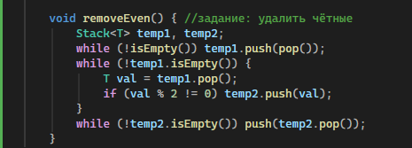
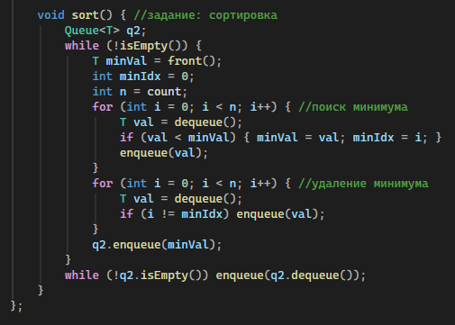
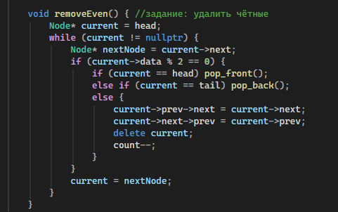
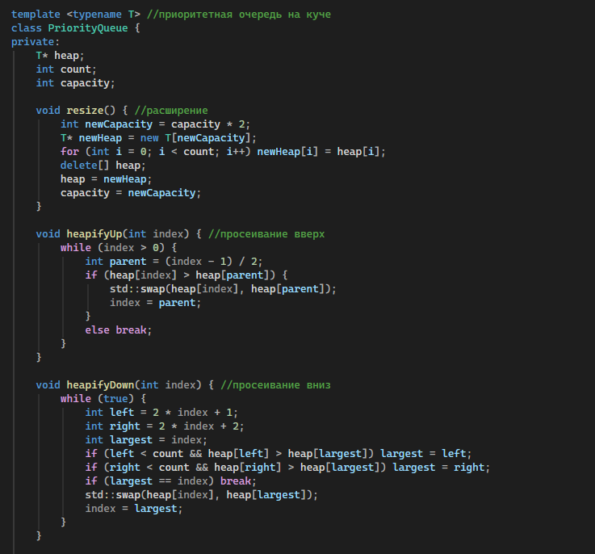
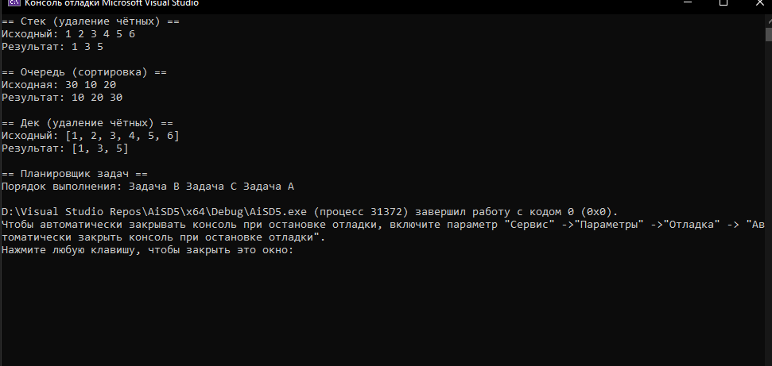

# Отчет к лабораторной работе № 5
# Тема: Стек, очередь, дек, приоритетная очередь 
# Дисциплина: Алгоритмы и структуры данных
## Выполнил: Бойко Андрей Сергеевич ПИЖ-б-о-25-2
# Цель:
1. Реализовать основные линейные структуры данных: стек, очередь, дек и приоритетную очередь 
2. Освоить принципы LIFO (стек) и FIFO (очередь) 
3. Научиться реализовывать эти структуры на основе динамического массива и связного списка 
4. Изучить применение стека для решения задач (проверка скобок, обратная польская запись) 
5. Реализовать приоритетную очередь на основе кучи (heap) 
# Ход работы

Согласно заданию реализовал стек и добавил функцию удаления всех чётных элементов

Реализовал очередь и добавил функцию сортировки

Реализовал дек и добавил функцию удаления всех чётных элементов

Реализовал приоритетную очередь и настроил симуляцию приоритетов задач

Запустил программу, убедился, что всё работает
# Вывод:
1. Реализовали основные линейные структуры данных: стек, очередь, дек и приоритетную очередь 
2. Освоили принципы LIFO (стек) и FIFO (очередь) 
3. Научились реализовывать эти структуры на основе динамического массива и связного списка 
4. Изучили применение стека для решения задач (проверка скобок, обратная польская запись) 
5. Реализовали приоритетную очередь на основе кучи (heap) 
# Ответы на контрольные вопросы:
1 Принцип LIFO означает «последним пришёл - первым ушёл»: элемент, добавленный последним, извлекается первым (аналогия со стопкой тарелок).
2 Принцип FIFO означает «первым пришёл - первым ушёл»: элементы извлекаются строго в порядке их добавления (аналогия с очередью в магазине).
3 Обычная очередь добавляет в конец и извлекает из начала, а дек позволяет добавлять и удалять элементы с обоих концов за O(1).
4 Это структура, где элементы извлекаются по приоритету, а не по порядку добавления; применяется в планировщиках ОС, алгоритме Дейкстры и сжатии Хаффмана.
5 Создается массив и индекс вершины (topIndex): при push индекс растет (с расширением массива при переполнении), а при pop значение берется, а индекс уменьшается.
6 Используется массив и два индекса (front и rear), которые сдвигаются по кругу через остаток от деления, что позволяет использовать память повторно.
7 Двоичная куча позволяет делать вставку и извлечение за O(log n), что быстрее, чем сортировка массива (O(n log n)) или поиск максимума перебором (O(n)).
8 Сложность push - O(1) амортизированное (из-за редкого расширения), а pop - строго O(1).
9 Сложность enqueue - O(1) амортизированное (в динамическом массиве), dequeue - строго O(1), а в кольцевом буфере обе операции строго O(1).
10 Сложность push и pop - O(log n), так как после каждой операции нужно восстанавливать свойства кучи (просеивание) по ее высоте.
11 Открывающие скобки кладутся в стек, при встрече закрывающей - извлекается верхняя и проверяется на соответствие, а если в конце стек пуст - скобки расставлены верно.
12 Добавление идет в первый стек, а при извлечении элементы перекладываются во второй; сложность dequeue - O(n) в худшем, но O(1) амортизированная.
13 Хранятся указатели на начало (head) и конец (tail), а добавление и удаление сводится к перестановке указателей prev и next за O(1).
14 Используется массив и два индекса (front и rear), которые могут двигаться в обе стороны по кругу за O(1).
15 Используются два стека (основной и стек для минимумов): во вспомогательный кладется текущий минимум, поэтому его вершина всегда хранит актуальный минимум, доступ за O(1).
